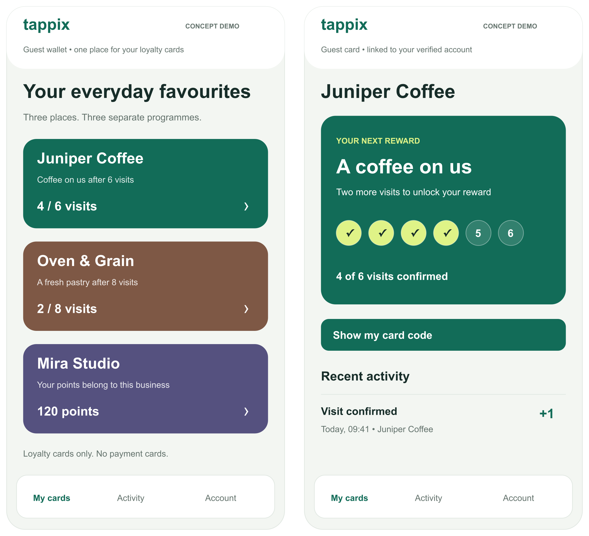
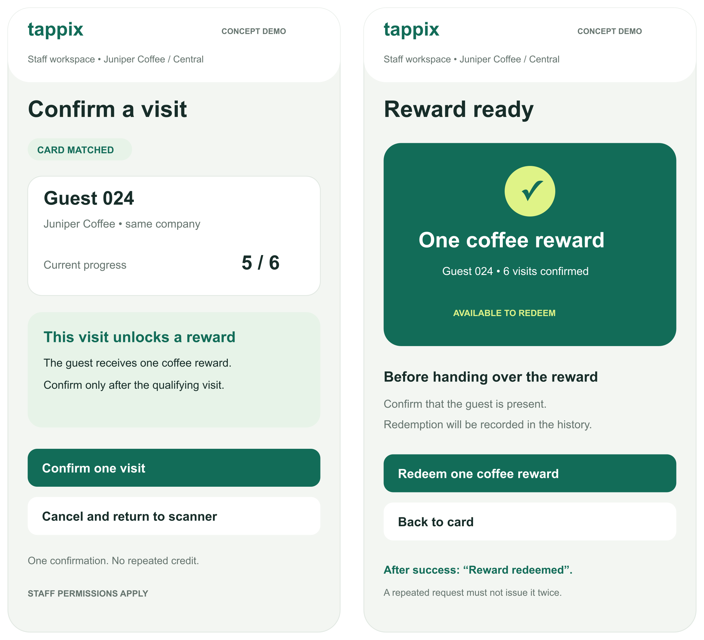
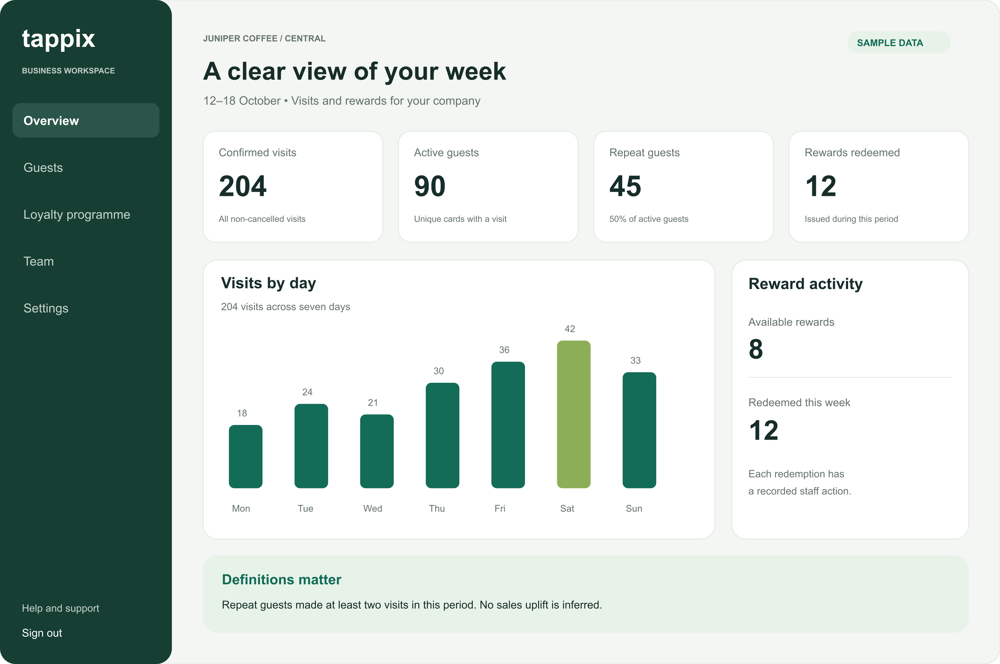
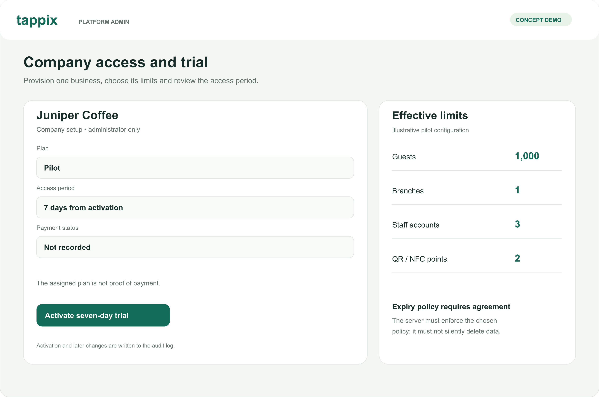

# Tappix concept prototype

[DIP-13](https://tappix-diploma.youtrack.cloud/issue/DIP-13), updated 24 October 2026.

Six new static vector concepts explain the four-role workflow. They were drawn
for this diploma package with AI assistance, without application screenshots.
Businesses, guest identifiers and activity values are fictional. Editable SVG
sources accompany PNG exports. Earlier screenshots are superseded in this edition
and remain only in Git history.

## Guest wallet and progress

P01 keeps separate business cards in one wallet, not a payment wallet. P02 shows
four of six confirmed visits. Linking cards requires verified ownership.

- [P01 wallet](01-guest-wallet.png) · [SVG](01-guest-wallet.svg)
- [P02 progress](02-guest-progress.png) · [SVG](02-guest-progress.svg)

## Staff confirmation and reward

P03 begins at five visits, a later state than P02. One qualifying visit unlocks
P04. Redemption is a distinct operation. Its success must remove the redemption
action; server-side transactions and idempotency must prevent repeats.

- [P03 confirmation](03-staff-confirmation.png) · [SVG](03-staff-confirmation.svg)
- [P04 redemption](04-reward-redemption.png) · [SVG](04-reward-redemption.svg)

## Owner overview

P05 shows 204 visits (18 + 24 + 21 + 30 + 36 + 42 + 33), 90 active guests and
45 repeat guests. The resulting 50% is a period repeat-guest share, not retention
or sales uplift. Twelve redeemed rewards and eight currently available rewards
are different measures. [SVG](05-owner-overview.svg).

## Administrator trial

P06 illustrates seven-day access, candidate pilot limits and payment not recorded.
Limits are not approved commercial terms. Expiry rules need agreement and must
not silently delete customer data. [SVG](06-admin-trial.svg).

## Evaluation limits

Images do not implement camera access, authentication, tenant isolation or reward
accounting. Enrolment, recovery, denied access, empty states, timeouts and keyboard
interaction require further design and tests. No real QR credentials or customer
records are embedded. POS integrations, campaigns, partner transfers, payment
processing and AI features are outside this concept. See the [report](../report/README.md).
