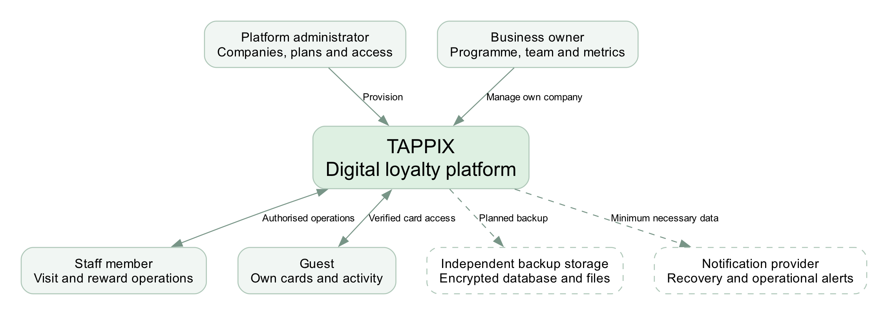
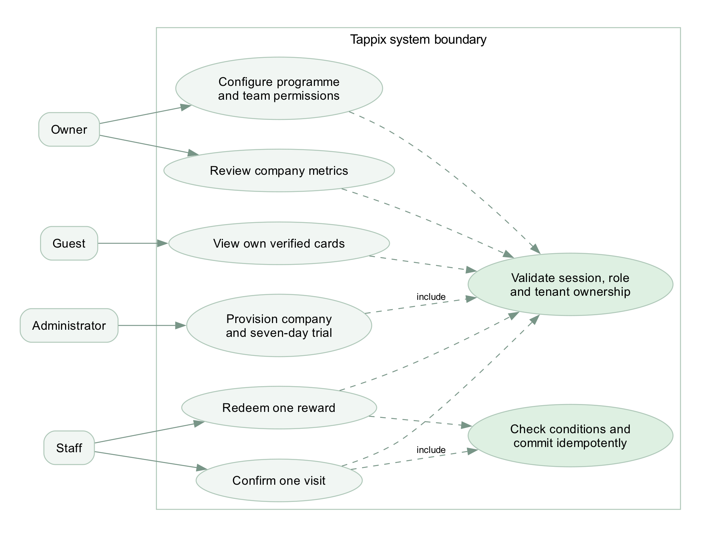
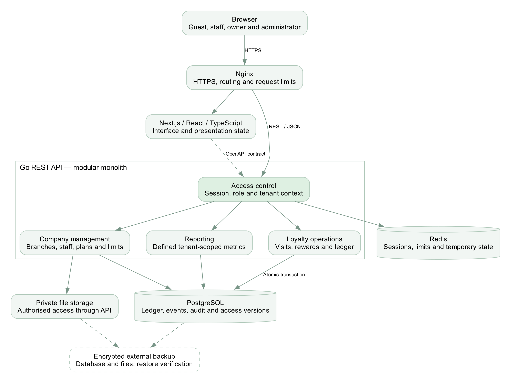

# Tappix first pre-defense report

English revision, 24 October 2026. 26 pages; 12 scientific studies and 14 official sources.

[PDF](en/Tappix-Pre-Defense-Report-EN.pdf) · [Editable Word](en/Tappix-Pre-Defense-Report-EN.docx)

First pre-defense report

Development of an Information System for Managing Customer Relationships in Small Businesses Through Digital Loyalty Programs.

Armat Islambekov • Yersultan Kambekov
Supervisor: Elvira Aitmukhanbetova
24 October 2026

### Executive summary

We propose a multi-tenant web platform for independent coffee shops, bakeries and salons in Kazakhstan. Guests keep digital loyalty cards, staff record qualifying visits and redeem rewards, and owners review activity within their own company. The platform administrator provisions businesses and assigns plans and a seven-day trial.

This submission defines the problem, evidence, requirements, architecture and evaluation method. Six newly designed static interface concepts illustrate the intended workflow. They are not screenshots of the existing application and do not demonstrate implemented functionality.

The principal engineering question is whether the system can combine company isolation, consistent reward accounting and a usable service-counter workflow. Demand, willingness to pay and sales impact remain hypotheses for real-world evaluation.

### Reading guide

| Part | Pages | Purpose |
| --- | --- | --- |
| Research and scope | 2–7 | Problem, 12 research studies, alternatives and choices |
| System design | 8–12 | Requirements, safeguards and architecture |
| Concept prototype | 13–16 | Guest, staff, owner and administrator journeys |
| Evaluation and delivery | 17–22 | Experiments, work plan, criteria and 26 references |
| Design discussions | 23–26 | AI role simulations and response to teacher feedback |

Revision of 24 October 2026: expanded scientific review and explicit links between evidence, design choices and evaluation. The appendix contains AI-simulated discussions, not participant interviews. Teacher feedback is recorded separately from the simulated adviser dialogue.

## 01  Problem and project scope

A limited product scope makes the system testable and keeps the two-student implementation feasible.

### Problem and research question

Paper cards and manually maintained records may leave owners without a consistent history of visits and rewards. Staff may need to resolve lost cards or disputed redemptions, while guests may struggle to understand their progress. These are proposed problems, not findings from interviews with Kazakhstani businesses.

Research question: can a web-based loyalty system provide correct, company-isolated accounting and a clear customer-service workflow that compares favourably with a familiar manual process? The expected contribution is an implemented and reproducibly evaluated information system, not a novel loyalty algorithm.

| User | Primary task | Access boundary |
| --- | --- | --- |
| Platform administrator | Provision companies, plans, limits and trials | Explicit platform permissions with audit records |
| Business owner | Manage programme, branches, team and metrics | Resources of their own company |
| Staff member | Identify a card, confirm a visit, redeem a reward | Assigned company, branch and allowed operations |
| Guest | View own cards, progress and activity | Cards linked through verified identity |

### Objectives and expected outputs

Study relevant literature and actual service-counter behaviour.

Specify roles, data relationships, API contracts and transaction rules.

Implement visits, rewards and a points ledger with idempotent operations.

Evaluate isolation, concurrency, usability, performance and recovery.

Final outputs should include source code, database migrations, an OpenAPI contract, automated tests, deployment and recovery instructions, and an evaluation report. This milestone provides their design basis.

### Included and deferred

The core includes visit-based rewards, loyalty points, displayed discount rules, a guest wallet, owner metrics and administrator-assigned access. Points are programme units rather than money; the wallet does not hold payment cards. Automated billing, POS integrations, mass paid messaging, AI recommendations and native apps are deferred.

## 02  What loyalty research establishes

Twelve scientific publications inform the design. Their findings do not establish demand for Tappix in Kazakhstan.

### Review method and boundaries

We selected research on programme effectiveness, reward progress, digital engagement and measurement bias. The search combined these themes with loyalty programme and customer retention terms. Publisher abstracts, accessible article sections and author or university copies were checked on 24 October 2026. This is a focused narrative review, not a systematic review with an exhaustive search or a quality-scored study pool.

The register contains twelve scientific publications [S1–S12], three product sources [P1–P3] and eleven technical sources [T1–T11]. Older studies are retained for their experimental or measurement contribution; recent studies add digital and contextual evidence. Where full text was unavailable, conclusions are limited to the accessible abstract and excerpts.

### Participation is not the same as loyalty

Belli et al. [S1] synthesise 429 effect sizes and distinguish behavioural loyalty from attitudes toward a business. Chen et al. [S2] organise 131 publications by theory, context, programme characteristics and method. Together, they suggest that a programme should be described through its rules and setting before its effectiveness is assessed. A count of registered cards alone does not answer whether guests return more often.

Dorotic et al. [S9] explain why apparently conflicting results can coexist: programme effects vary across customer segments and markets. For Tappix, the initial unit of analysis should therefore be one business and its eligible guests. Aggregating unrelated salons and coffee shops into a single return rate would obscure different visit cycles.

### Software can record an outcome without causing it

Mittal et al. [S3] report positive associations between satisfaction and customer or firm outcomes across 245 articles, with contextual variation. Liu-Thompkins et al. [S4] examine cognitive, affective and social drivers across 319 studies. These findings make service quality and customer experience relevant context; they do not show that issuing a digital card produces profit.

We consequently define the engineering contribution as reliable event recording, access boundaries and a usable counter workflow. Business benefit is a separate evaluation question. The owner dashboard will report visits and redemptions with named definitions, rather than displaying an unsupported sales-growth estimate.

### A specific design consequence

FR-06 requires dashboard totals to reproduce a known event dataset. This is a correctness requirement derived by the team, not a result claimed by the marketing studies. A pilot can later investigate whether owners find these measures useful for decisions.

## 03  Progress and digital engagement

### Why the card shows progress

Kivetz et al. [S8] study the goal-gradient mechanism in reward programmes. Nunes and Drèze [S12] show that an endowed start can change persistence even when the remaining effort is unchanged. Both concern how a goal is perceived; neither justifies treating an unearned visit as a real purchase.

The concept therefore shows four confirmed visits out of six, a named reward and two remaining visits. If a business later offers a welcome credit, the interface and ledger must distinguish that promotion from a visit. We defer such promotions in the first implementation so the basic history stays easy to explain.

### A mobile channel does not remove operational friction

Son and Oh [S5] investigate reward redemption and engagement as loyalty becomes mobile. Their research motivates recording how guests use rewards over time, rather than counting enrolment alone. It does not establish that our web interface is preferable to a native wallet. We choose a link-based card to reduce installation steps and will test whether guests can find it again.

The staff design includes confirmation before a visit and a separate redemption action. These choices are operational hypotheses: a fast scanner is of little use if a cashier cannot tell whether a timed-out request succeeded. The evaluation must include camera refusal and a response lost after the database commit.

### Context changes the meaning of activity

Jin et al. [S6] analyse point use around a major external disruption and identify differences between usage groups. Kuikka et al. [S7] examine 45,603 grocery-retailer reviews across pandemic-related periods. These contexts are unlike an independent Kazakhstani café, but they show why an activity change needs an explanation beyond the software launch.

During a pilot we should record promotions, opening hours, programme-rule changes and interruptions. Qualitative comments can explain a frustrating redemption; they cannot substitute for a visit record. Conversely, a visit total cannot explain why a guest abandoned registration.

### Resulting prototype decisions

P02 makes the reward and remaining effort visible. P03 and P04 separate an attempted operation from a confirmed result. P05 separates current available rewards from redemptions within a selected period. These are testable interface decisions, not findings from interviews.

## 04  Measurement and research gap

### The selection problem

Leenheer et al. [S10] use household panel data and model the decision to join a programme. The estimated programme effect is smaller when self-selection is considered. This matters because guests who already visit often may be the first to register. Comparing registered and unregistered guests once would confound the programme with their earlier behaviour.

Liu [S11] follows a convenience-store programme over time and finds different responses among initially heavy, moderate and light buyers. A single average can therefore hide which guests changed behaviour. Tappix should retain timestamps and programme versions so later analysis can distinguish existing regulars from newer guests.

### What the first pilot can answer

A short pilot can establish whether a staff member records a valid visit without help, whether the reward is issued once, and whether the owner understands a metric. It cannot establish a stable retention effect for businesses with infrequent visits. A salon may require a longer observation window than a coffee shop; the period must be chosen before interpreting results.

For example, 45 repeat cards among 90 active cards in one week yields a 50% within-period repeat share. It says nothing about how many of last month’s guests returned this month. A retention cohort would require a separately specified starting population and follow-up window. The distinction is built into the metric definitions and usability questions.

| Evidence | Design or evaluation consequence |
| --- | --- |
| Programme context and heterogeneity [S1, S2, S9, S11] | Retain company, programme and period context; avoid a universal uplift claim. |
| Progress framing [S8, S12] | Show confirmed progress and explicit reward conditions; test comprehension. |
| Engagement and external changes [S5–S7] | Keep event history and note concurrent operational changes during a pilot. |
| Selection and outcome measurement [S3, S4, S10] | Separate software correctness, reported experience and causal business effects. |

### Applied contribution

The proposed contribution is a small multi-tenant information system whose reward operations and reports can be reproduced and checked. The literature motivates what to measure; it does not resolve local purchasing decisions, willingness to pay or required staff training. The simulated dialogues in Appendix A generate candidate checks for those unresolved questions.

## 05  Existing solutions and alternatives

Comparison method: documentation review of official product pages [P1–P3], not hands-on account testing. “Unverified” does not mean “unavailable”.

| Criterion | Loyverse [P1] | Poster [P2] | Loopy Loyalty [P3] |
| --- | --- | --- | --- |
| Primary workflow | Loyalty within POS | Restaurant POS loyalty | Digital stamp cards |
| Guest enrolment | Name, phone or barcode card | POS entry or customer import | QR or link to mobile Wallet |
| Mechanics | Purchase points and redemption discount | Discounts, bonuses and promotions | Stamps and rewards |
| Staff action | Attach customer to sale | Serve customer at POS | Stamper App |
| Guest view | Points on printed or emailed receipt | Guest web portal unverified | Apple / Google Wallet |
| Analytics | Visits, points and purchase history | Receipts, discounts and guest bonuses | Cards, stamps and rewards |
| Multiple locations | Earn and redeem across account stores | Loyalty-specific location terms unverified | Multi-user and multi-location advertised |
| Data and integrations | Customer import and export | Customer import and campaign export | Zapier and Make advertised |

### Manual alternatives and switching cost

A paper card is simple to introduce but may not provide a shared owner history. A spreadsheet can record events without another subscription, at the cost of manual entry and access management. These are analytical assumptions to verify through observation. Keeping the current process is reasonable when switching costs exceed the expected benefit.

### Proposed position of Tappix

Tappix explores a standalone web card and staff workflow without requiring a cash-register replacement. The intended distinction is a small, understandable feature set with company-scoped access and explicit metric definitions. Existing products already cover much of the use case; this comparison does not establish that Tappix is better.

Unverified areas include exact role permissions, Kazakh localisation, complete history exports, plan limits and data-hosting terms. Prices are not compared without matching service scope. Willingness to pay remains an open question.

## 06  Technology decisions

The team selected Go, PostgreSQL and Next.js as a starting point. The alternatives below explain the trade-offs; they are not the result of a fabricated benchmark.

| Decision | Reason in this project | Trade-off |
| --- | --- | --- |
| Go REST API [T5] — selected | Explicit backend boundary; standard HTTP and test tooling | Two implementation languages; maintain validation and OpenAPI |
| Node.js / TypeScript [T6] | A shared language across client and server | Language reuse does not ensure isolation or atomic accounting |
| Python / FastAPI [T7] | Typed request models and generated OpenAPI | Changes the agreed backend ecosystem and ownership |
| PostgreSQL [T1–T2] — selected | Transactions, relational constraints and optional row security | Migrations, indexes and policies require explicit verification |
| MySQL / InnoDB [T3] | Relational transactional alternative | Revisit schema details and tenant-protection strategy |
| MongoDB [T4] | Flexible documents and multi-document transactions | Linked cards, visits and ledger entries need explicit consistency rules |
| Next.js / React [T8–T9] — selected | Framework routing and React-based interface | Avoid duplicating Go business rules in the UI |
| React SPA [T9] | Independent choices for routing and API integration | More application structure decisions to maintain |
| Vue [T10] | Alternative component-based interface model | Revises the agreed frontend ecosystem |

### Supporting infrastructure

Redis [T11] is proposed for sessions, rate limiting and temporary work. PostgreSQL remains the durable record for loyalty events, audit entries and access revocation versions. Redis persistence alone is not the recovery strategy. Docker packages services; Nginx terminates HTTPS and routes requests.

This combination fits the students’ responsibilities and the transactional domain. Performance, operating cost and capacity remain to be measured. If access validation is unavailable, sensitive write operations must fail safely.

## 07  Functional requirements

Must denotes core acceptance; Should denotes a lower-priority capability after the accounting and access-control core is validated.

| ID | Priority | Capability and acceptance criterion |
| --- | --- | --- |
| FR-01 | Must | Only the platform administrator provisions companies. A direct owner API call cannot create another company. |
| FR-02 | Must | Changing an identifier cannot expose or modify another company’s cards, guests, files, branches or reports. |
| FR-03 | Must | A qualifying threshold visit creates one reward entitlement. Concurrent retries do not create duplicate visits or rewards. |
| FR-04 | Must | Point credits and debits produce ledger records atomically. The derived balance agrees with those records. |
| FR-05 | Must | A verified guest can keep cards from several businesses. Each business still sees only its own records. |
| FR-06 | Must | Owner metrics have definitions that reproduce totals from a known synthetic event dataset. |
| FR-07 | Must | Plans, individual overrides and seven-day trials are enforced on the server; UI limits and usage agree with the API. |
| FR-08 | Must | Staff accounts can be assigned only to branches belonging to the same company. |
| FR-09 | Should | The applicable discount is shown with its conditions; it is not recorded as a received payment. |
| FR-10 | Must | A database-and-files backup restores in an isolated environment with linked attachments verified. |

### Business rules that cannot rely on the interface

A scanned QR or NFC link identifies a card; it does not authorise a visit. The trusted company context comes from the validated session and membership. An assigned plan is not proof of payment. Points are not transferable money, and a multi-card wallet does not merge businesses’ customer databases.

### Open decisions before implementation

Agree the guest identity and recovery mechanism, reward rollover, corrections and point expiry. Confirm the trial start event, time boundary and post-expiry access. The concept shows activation as one candidate start event; it is not an approved policy. Data retention and the service operator also remain to be confirmed.

## 08  Quality and protection requirements

These are planned acceptance checks, not claims that the new repository already provides the protections.

| ID | Priority | Evidence required |
| --- | --- | --- |
| NFR-01 | Must | Cross-company negative tests cover every relevant read and write; responses disclose no foreign personal data. |
| NFR-02 | Must | Twenty concurrent repeats with one idempotency key produce one effect. Changed payloads with the same key are rejected. |
| NFR-03 | Must | Two distinct requests competing for one reward cannot redeem it twice; durable state and responses agree. |
| NFR-04 | Must | After logout or company suspension, the old session cannot regain access after reactivation. |
| NFR-05 | Must | Restore database and files; compare record counts, relationships and attachment hashes. |
| NFR-06 | Should | At 360 px width, key flows do not overflow horizontally; keyboard access and labels remain usable. |
| NFR-07 | Should | Proposed write-API target: p95 below 500 ms at 20 concurrent clients, measured under documented conditions. |
| NFR-08 | Must | No real credentials or customer data in the repository; release review also covers history, images and logs. |

### Accounting and session design

Scope each idempotency key by company, actor and operation, and bind it to a request-body hash. Store the operation result in the same transaction as the visit or ledger change. Use database constraints and appropriate locking to enforce invariants. A retry after a lost response must recover the committed result rather than repeat the effect.

Durable access versions prevent Redis resets or company reactivation from reviving revoked sessions. Tenant-scoped relational constraints and, where appropriate, row security add protection; neither replaces explicit authorisation. Log sensitive actions without recording tokens or unnecessary personal data.

### Operational boundary

Keep PostgreSQL and Redis off public interfaces, protect private files through authorised access, and separate recovery credentials from the server. External encrypted backup storage has not been connected in the diploma repository. Before a pilot, validate actual restoration, alert delivery and expiry reminders independent of the application server.

## 09  System context

Four user roles interact with one platform. Each business remains a separate tenant.

Figure 1. Proposed system context. Dashed connections represent planned external services.

### Trust boundaries

Owners and staff operate only within their authorised company. Guests see only cards that have been linked through verified identity. The platform administrator has separately authorised provisioning functions and an audit trail. Notification providers receive only the data required for their purpose.

Backups must survive loss of the application host. A snapshot retained by the same provider may help recovery but does not replace a separately controlled, encrypted copy and a verified restore procedure.

## 10  Principal use cases

The central workflow is identify a card, validate access, commit a visit and redeem an available reward.

Figure 2. Compact use-case view using UML-like notation in editable DOT. Dashed links denote included checks; this is not a complete formal UML model.

### A deliberate confirmation step

Identifying a guest must not automatically credit a visit. Staff first see the matched company and current progress, then confirm one qualifying action. When a reward becomes available, redemption is a separate action recorded against the staff identity.

### Failure and correction paths

A foreign-company card produces a clear denial without guest details. A network timeout produces an uncertain state until the same operation can be checked or retried safely. Corrections must create auditable records rather than silently remove history. Exact correction and rollover rules require team review.

## 11  Component architecture

A modular monolith keeps deployment manageable while separating presentation, authorisation, accounting and reporting.

Figure 3. Go is the business-rule boundary. Redis is not the authoritative source of balances.

The interface consumes an explicit REST/JSON contract. Reporting aggregates authorised company events using named definitions. Database transactions cover ledger and reward changes; file authorisation is enforced before returning private content. Database schema and migrations remain a separate implementation task.

## 12  Guest experience

New conceptual screens • fictional businesses and sample values • no current-application screenshots

Figure 4. P01 shows separate loyalty cards; P02 explains the next reward and confirmed progress.

### Interaction intent

The wallet brings verified cards together without combining programmes. The card view gives one primary action, a concrete reward and a count of remaining visits. Colour is supported by text and numbers. A visit history helps the guest understand changes.

These static SVG/PNG designs were created for this report. Buttons are illustrative; identity verification, QR presentation, navigation and history retrieval are not implemented by the images. The production interface may require Russian and Kazakh localisation.

## 13  Staff experience

One qualifying visit and one reward redemption are distinct, auditable operations.

Figure 5. P03 begins at 5/6 confirmed visits; the next valid visit enables the reward in P04. P02 shows an earlier 4/6 state.

### States that must be tested

The confirmation screen shows the matched company and intended effect before the write. After redemption succeeds, the interface must show the recorded result and remove the available redemption action. Disabling a button improves clarity but is not the protection against duplicate requests.

Test camera denial, a foreign-company card, an expired session, a timeout after commit and simultaneous redemption. An alternative lookup must preserve the same access checks. No real QR credential or customer identity appears in these concepts.

## 14  Owner overview

The dashboard prioritises a small set of defined measures rather than unsupported growth claims.

Figure 6. P05 uses a deliberately constructed example, not measurements from a real business.

| Measure | Definition in the concept |
| --- | --- |
| Confirmed visits | 204 non-cancelled visit events during the selected week. |
| Active guests | 90 unique cards with at least one visit in the period. |
| Repeat guests | 45 of those cards have at least two visits; 45 / 90 = 50%. |
| Rewards redeemed | 12 recorded redemptions during the period; 8 currently available rewards are a separate stock measure. |

The bars use 18, 24, 21, 30, 36, 42 and 33 visits, which sum to 204. This checks internal arithmetic only. In the implemented system, selected company, branch, timezone and date interval must be explicit, and all totals must be reproducible from events.

A period repeat-guest share is not a 30-day retention cohort and does not estimate incremental revenue. With no activity, the dashboard should show an explanatory empty state rather than artificial trends.

## 15  Administrator access

The administrator connects a business, assigns its effective limits and controls the trial period.

Figure 7. P06 illustrates a candidate pilot configuration. The displayed quotas are examples, not approved commercial terms.

### Plan and payment are different records

The design separates the assigned plan from payment status. An administrator may provide trial access without recording a payment. Individual overrides must be visible alongside usage, and the server must enforce the effective values rather than trusting hidden interface controls.

### Trial boundary and data protection

The concept proposes a seven-day window from activation. The team still needs to approve the start event, timezone boundary and permitted actions after expiry. Expiry must not silently delete customer data. Subsequent blocking and unblocking must not restore previously revoked sessions.

### Prototype scope

The six screens cover the primary four roles. They deliberately omit campaign builders, partner transfers, payment processing, POS integrations and AI features. A complete interaction design still needs enrolment, recovery, empty/error states and accessible keyboard behaviour. Their absence is recorded rather than hidden by a polished appearance.

## 16  Evaluation method

The following thresholds are proposed experiment criteria. No experiment results are reported at this stage.

| Question | Method | Evidence and decision |
| --- | --- | --- |
| Is the problem real? | Discuss recent loyalty tasks with 3–5 owners or staff. Observe the current workflow. | Record actual workarounds, frequency, effort and decision authority; narrow scope if the proposed problem is not present. |
| Is the workflow understandable? | At least five participants attempt card access, visit confirmation, redemption and metric interpretation. Compare with a paper/manual baseline. | Record completion, time, errors and assistance. Proposed next-iteration criterion: 4/5 complete the core flow unaided; any incorrect reward issue triggers redesign. |
| Are tenants isolated? | Use owner, staff and guest roles across two companies; change identifiers in paths, queries and request bodies. | Verify denied responses, absence of foreign fields and unchanged database state. |
| Are writes safe to repeat? | 20 concurrent same-key requests, then 20 different keys for one reward; repeat 50 times. Simulate a response lost after commit. | One intended effect, consistent responses and ledger state; reject changed bodies with reused keys. |
| Is capacity adequate? | 10 synthetic companies × 100 guests, 2 branches and 3 staff each. 2 vCPU / 4 GiB host; separate load generator. | 2-minute warm-up, 10-minute measurement, 3 runs. Report p50/p95/p99, errors, CPU/RAM and DB timings. |
| Can data be recovered? | Restore encrypted database and file backups on an isolated clean environment. | Verify records, relationships and attachment hashes; measure recovery time and backup age. |

### Recovery targets and limits

Proposed pilot targets are an RPO of up to 24 hours and an RTO of up to 4 hours. These are not achieved service guarantees. A daily backup can lose events since the last successful copy; a smaller RPO needs more frequent protection or WAL archiving. Retain the recovery key separately and alert on missing or failed backups.

### Pilot interpretation

After technical checks, a 2–3 business pilot can test operational fit. Record service changes, promotions, staffing and seasonality. A small uncontrolled pilot cannot establish general market demand or causal sales growth. Do not convert five usability participants into a market-success percentage.

## 17  Work plan and collaboration

The first submission is due 24 October 2026. Dates for subsequent milestones remain to be agreed.

| Tasks | Owner | Deliverable and acceptance |
| --- | --- | --- |
| DIP-1 | Armat | Private repository and YouTrack setup; completed. |
| DIP-2 / 3 | Armat / Yersultan | Documentation and repository CI; PRs await personal peer review. Existing CI material was prepared by Armat with AI. |
| DIP-11 / 12 | Armat | Literature/comparisons and three architecture diagrams; review pending. |
| DIP-13 / 14 | Armat | Concept prototype and report package; updated English edition prepared for review. |
| DIP-4 | Yersultan | Go health slice and contract tests after the repository baseline. |
| DIP-5 | Armat | Next.js shell after baseline and API contract agreement. |
| DIP-6 / 7 | Yersultan | Isolated Docker/Nginx environment, ER model and reversible migrations after domain-rule review. |
| DIP-8 / 9 / 10 | Armat | Evidence, team access/dates and review safeguards; remaining confirmations tracked separately. |

### Responsibilities and honest provenance

Armat owns frontend, UX and visualisation. Yersultan owns Go, PostgreSQL, Redis and infrastructure. Each student uses their own account and records their own work. AI-prepared material committed by Armat is not represented as Yersultan’s personal contribution. The existing implementation and its Git history remain separate.

GitHub: islqdev/tappix-diploma. Yersultan’s Ersultan7 account has accepted collaborator access. PRs #1–6 form a dependent sequence and await his review. Merge in order after approval; create pre-defense-1 on the accepted revision and never move the tag. Automatic branch protection was not confirmed for the private repository; the agreed review procedure remains a team rule.

### Principal risks

Unconfirmed user need: obtain real discussions and review the scope.

Unsettled identity, reversal and expiry rules: agree before schema/API work.

Scope expansion: defer integrations and AI until the core passes acceptance.

Operational data loss: verify independent backups before a pilot.

The English report and newly drawn concepts are an updated delivery edition. This document does not claim that the revision has already been approved, merged or tagged.

## 18  Submission status and next steps

Materials are mapped to the supplied first-pre-defense requirements; preparation is not the same as university acceptance.

| Requirement | Evidence in this report | Status |
| --- | --- | --- |
| Problem, aim, scope and team | Pages 1–2 and 18 | Prepared |
| 3–5 real discussions or client agreement | Plan on page 17; AI scenarios in Appendix A | Not yet obtained |
| At least 12 sources, including 8 scientific | 12 scientific studies plus 14 official sources; pages 20–22 | Prepared with access limitations |
| 3–5 analogues, 6–10 criteria | 3 products across 8 criteria; manual alternatives included | Prepared |
| 3 technology choices with alternatives | Go, PostgreSQL and Next.js; two alternatives each | Prepared; no benchmark |
| Functional and quality requirements | FR and NFR with priorities and acceptance evidence | Prepared; open rules listed |
| Context, use-case and component diagrams | Editable DOT with PNG/SVG exports | Prepared |
| Principal user-flow prototype | 6 new vector concepts across all four roles | Prepared; static only |
| Evaluation method and baseline | Usability, isolation, concurrency, load and recovery plan | Prepared; not executed |
| Git, tasks, ownership and milestones | Repository and YouTrack; dependencies and risks | Peer review and merge pending |
| Supervisor feedback and response | Teacher comment and response on page 26; adviser role-play separately labelled | Comment received; approval pending |

### What the team should do next

The teacher requested at least 12 sources and more substantive presentation. This revision adds four scientific studies, thematic synthesis and traceable design decisions. Appendix A contains permitted AI role-play for requirements exploration; it supplies no real participant evidence. Ask the supervisor to confirm whether that exercise is acceptable for this milestone before treating the user-discussion criterion as satisfied.

Yersultan should personally review the repository changes from his account. Address findings before merging and tagging the accepted baseline. Then implement the smallest working API/UI slice and extend it through testable, task-linked pull requests.

This edition replaces the previous Russian report and screenshots for presentation purposes. It does not replace the application, create customer data or establish production readiness.

## 19  Scientific references

Source access was documented on 24 October 2026. Access limitations and project implications are discussed on pages 3–5.

[S1] Belli, A., O’Rourke, A.-M., Carrillat, F. A., Pupovac, L., Melnyk, V., & Napolova, E. (2022). 40 years of loyalty programs: how effective are they? Generalizations from a meta-analysis. Journal of the Academy of Marketing Science, 50, 147–173.

[DOI](https://doi.org/10.1007/s11747-021-00804-z)

[S2] Chen, Y., Mandler, T., & Meyer-Waarden, L. (2021). Three decades of research on loyalty programs: A literature review and future research agenda. Journal of Business Research, 124, 179–197.

[DOI](https://doi.org/10.1016/j.jbusres.2020.11.057)

[S3] Mittal, V., Han, K., Frennea, C., Blut, M., Shaik, M., Bosukonda, N., & Sridhar, S. (2023). Customer satisfaction, loyalty behaviors, and firm financial performance: what 40 years of research tells us. Marketing Letters, 34, 171–187.

[DOI](https://doi.org/10.1007/s11002-023-09671-w)

[S4] Liu-Thompkins, Y., Khoshghadam, L., Attar Shoushtari, A., & Zal, S. (2022). What drives retailer loyalty? A meta-analysis of the role of cognitive, affective, and social factors across five decades. Journal of Retailing, 98(1), 92–110.

[DOI](https://doi.org/10.1016/j.jretai.2022.02.005)

[S5] Son, Y., & Oh, W. (2023). Digitalization of Loyalty: Impacts of Mobile Technology on Reward Redemption and Engagement Level. Journal of Management Information Systems, 40(4), 1301–1327.

[DOI](https://doi.org/10.1080/07421222.2023.2267313)

[S6] Jin, X., Kim, T., & Lee, D. (2024). Spending points during crises: Adaptive behavior on E-loyalty programs. Electronic Commerce Research and Applications, 65, 101408.

[DOI](https://doi.org/10.1016/j.elerap.2024.101408)

## Scientific references continued

Sources S7–S12. DOI links identify the published articles; access may require a university subscription.

[S7] Kuikka, A., Hallikainen, H., Tuominen, S., & Laukkanen, T. (2025). What drives customer loyalty in a pandemic? Semantic analysis of grocery retailers. Electronic Commerce Research, 25, 2205–2240. Published online 2024.

[DOI](https://doi.org/10.1007/s10660-024-09857-y)

[S8] Kivetz, R., Urminsky, O., & Zheng, Y. (2006). The Goal-Gradient Hypothesis Resurrected: Purchase Acceleration, Illusionary Goal Progress, and Customer Retention. Journal of Marketing Research, 43(1), 39–58.

[DOI](https://doi.org/10.1509/jmkr.43.1.39)

[S9] Dorotic, M., Bijmolt, T. H. A., & Verhoef, P. C. (2012). Loyalty programmes: Current knowledge and research directions. International Journal of Management Reviews, 14(3), 217–237.

[DOI](https://doi.org/10.1111/j.1468-2370.2011.00314.x)

[S10] Leenheer, J., van Heerde, H. J., Bijmolt, T. H. A., & Smidts, A. (2007). Do loyalty programs really enhance behavioral loyalty? An empirical analysis accounting for self-selecting members. International Journal of Research in Marketing, 24(1), 31–47.

[DOI](https://doi.org/10.1016/j.ijresmar.2006.10.005)

[S11] Liu, Y. (2007). The long-term impact of loyalty programs on consumer purchase behavior and loyalty. Journal of Marketing, 71(4), 19–35.

[DOI](https://doi.org/10.1509/jmkg.71.4.019)

[S12] Nunes, J. C., & Drèze, X. (2006). The endowed progress effect: How artificial advancement increases effort. Journal of Consumer Research, 32(4), 504–512.

[DOI](https://doi.org/10.1086/500480)

## 20  Product and technical sources

Official documentation supports the comparison and design rationale. Vendor statements are not independent evidence of effectiveness.

[P1] Loyverse Loyalty Program

[https://loyverse.com/en-us/loyalty-program](https://loyverse.com/en-us/loyalty-program)

[P2] Poster Kazakhstan Marketing

[https://joinposter.kz/tour/marketing](https://joinposter.kz/tour/marketing)

[P3] Loopy Loyalty

[https://loopyloyalty.com/](https://loopyloyalty.com/)

[T1] PostgreSQL Transactions

[https://www.postgresql.org/docs/18/tutorial-transactions.html](https://www.postgresql.org/docs/18/tutorial-transactions.html)

[T2] PostgreSQL Row Security

[https://www.postgresql.org/docs/18/ddl-rowsecurity.html](https://www.postgresql.org/docs/18/ddl-rowsecurity.html)

[T3] MySQL InnoDB Transaction Model

[https://dev.mysql.com/doc/refman/8.4/en/innodb-transaction-model.html](https://dev.mysql.com/doc/refman/8.4/en/innodb-transaction-model.html)

[T4] MongoDB Transactions

[https://www.mongodb.com/docs/manual/core/transactions/](https://www.mongodb.com/docs/manual/core/transactions/)

[T5] Go Documentation

[https://go.dev/doc/](https://go.dev/doc/)

[T6] Node.js Introduction

[https://nodejs.org/en/learn/getting-started/introduction-to-nodejs](https://nodejs.org/en/learn/getting-started/introduction-to-nodejs)

[T7] FastAPI Features

[https://fastapi.tiangolo.com/features/](https://fastapi.tiangolo.com/features/)

[T8] Next.js Documentation

[https://nextjs.org/docs](https://nextjs.org/docs)

[T9] Creating a React App

[https://react.dev/learn/creating-a-react-app](https://react.dev/learn/creating-a-react-app)

[T10] Vue Introduction

[https://vuejs.org/guide/introduction.html](https://vuejs.org/guide/introduction.html)

[T11] Redis Persistence

[https://redis.io/docs/latest/operate/oss_and_stack/management/persistence/](https://redis.io/docs/latest/operate/oss_and_stack/management/persistence/)

### Project records

[GitHub](https://github.com/islqdev/tappix-diploma)

[YouTrack](https://tappix-diploma.youtrack.cloud/projects/DIP/issues)

The repository is private; a link alone does not grant access. The accompanying report, editable diagrams and prototype images can be reviewed without repository access.

## Appendix A  Simulated owner discussion

AI-generated design exercise. The characters and situations are fictional; no interview took place.

The exercise uses the four-role concept and a six-visit reward rule to expose objections before implementation. The team requested realistic role-play, including disagreement, rather than favourable testimonials. The dialogues are presented in English for this report. They are not translated interview transcripts, a participant sample or evidence of willingness to pay.

### Scenario A1  A coffee shop owner

Student: Before I show the screens, how would you handle a guest who says they lost a nearly completed paper card?

Owner role: If I recognise them, I might accept what they say. But the next person on shift may not know them. I would not want a new system to turn that argument into a longer queue.

Student: Would a history of confirmed visits help?

Owner role: Maybe. Who corrects a mistake? A cashier can scan the wrong person, especially when two customers are standing together.

Student: We propose showing the matched card before confirmation. An authorised correction would leave an audit record instead of deleting the event.

Owner role: That sounds useful, but I still need to see how many steps it takes. My current cards do not need a charged phone or a password.

Student: What would you need to see before choosing whether to continue after a trial?

Owner role: That the staff can use it without calling me, that the numbers make sense, and that I can take my records if I leave. A pretty graph is not enough.

Student: Is seven days enough to judge it?

Owner role: To find annoying parts, probably. To say that people return more often, no. Some regulars might only visit once that week.

### Candidate requirements and unresolved questions

This scenario motivates a visible confirmation step, an auditable correction and a usable export. It also separates the access trial from the time needed to evaluate retention. The existing requirements FR-03 and FR-06 cover transaction correctness and metrics; correction permissions and export scope still need specification.

Validation to obtain: observe a real shift, record the current lost-card procedure and test a mistaken visit on synthetic data. No operational frequency, acceptable price or customer benefit can be inferred from this role-play.

## Appendix A  Simulated staff discussion

AI-generated role-play A2. This is a fictional counter scenario, not a report of observed staff behaviour.

### Scenario A2  A cashier during a busy shift

Student: The guest has five visits out of six. You scan the card and press Confirm visit. The connection drops before the result appears. What would you do?

Staff role: I would probably press it again. The guest is waiting and I cannot tell whether it worked.

Student: The same operation should return the earlier result if the first request committed. Until we know the result, the screen should say it is being checked.

Staff role: Then do not just show a red error. I will read that as “nothing happened”. And where do I look to check the last visit?

Student: We need a recent-operation result with the time and resulting progress. Would you issue the free coffee as soon as it reaches six?

Staff role: Only if the guest wants it now. They may want to keep the reward for next time. Also, I need to know whether it was already used at the other branch.

Student: Redemption is a separate action. The server checks the available reward and records one redemption, even if two staff members submit it.

Staff role: What if I scan a card from another café in the same wallet?

Student: It should say that this card belongs to another business and cannot be used here. It must not reveal that business’s customer history.

Staff role: Good. But do not make me log in again after every customer. I need an individual account that stays usable during my shift, and a clear way to lock it when I leave.

### Candidate requirements and test cases

FR-02, FR-03 and FR-08 cover company boundaries, single-effect writes and staff scope. Add an uncertain-result state to P03, a recent-operation lookup and explicit lock/logout behaviour. A proposed acceptance test drops the response after commit, retries with the same idempotency key and checks that one visit and one reward entitlement exist.

The simulated cashier’s tendency to retry is a scenario assumption. Usability testing must establish whether the wording actually prevents an incorrect second action; a server-side duplicate test alone cannot establish that.

## Appendix A  Simulated guest discussion

AI-generated role-play A3. No real guest, account, visit history or consent record is represented.

### Scenario A3  A guest with several cards

Student: You have cards for a café and a salon. Would keeping both in one account make the next visit easier?

Guest role: If I can find the right one quickly. I do not want the café to see when I visit the salon.

Student: The wallet groups cards for your access. Each business receives only its own card and activity. What would make you hesitate at registration?

Guest role: A long form. Also, why do you need my phone number? I do not want messages just because I want a stamp.

Student: The final registration flow needs a clear identity purpose and separate messaging choices. Which part of the sample card is unclear?

Guest role: “Six visits” could mean I get a free drink on the sixth visit or on the seventh. Say exactly when I can use it.

Student: The proposed rule creates a reward after the sixth qualifying visit. Using it is a separate step, subject to the stated programme conditions.

Guest role: And if I change my phone, do I lose all my cards?

Student: Recovery must verify that the account is yours. We should not merge two people just because somebody enters a matching phone number.

### Cross-scenario design actions

| Scenario | Action to specify or test | Acceptance evidence |
| --- | --- | --- |
| A1 owner | Correction rights and export; separate trial from pilot duration | Owner interprets a correction history and opens an export. |
| A2 staff | Uncertain result, recent operation and single redemption | Lost-response and concurrent-operation tests plus a staff task. |
| A3 guest | Reward wording, private wallet and verified recovery | Guest explains reward timing; cross-company and recovery tests. |

The scenarios produce candidate requirements, not a vote for the idea. No participant counts, satisfaction percentages or purchase commitments are reported. Real discussions should use past-behaviour questions before presenting the prototype and retain anonymised notes, including contradictory observations.

## Appendix B  Review and team response

Actual teacher feedback reported by Armat is separated from an AI-simulated adviser conversation.

### Received feedback

Armat relayed two comments from the teacher on 24 October 2026: the report looked generated, and it needed at least twelve sources. This is a student-reported summary; no signed review, original review file or acceptance of this revision was supplied.

Response: this edition contains twelve scientific publications and fourteen official product or technical sources. The literature section now compares findings, explains limits and connects them to requirements and evaluation choices. Generic summaries have been replaced with specific examples such as the difference between repeat share and retention, and a retry after a lost server response.

### Simulated adviser dialogue

The following exchange was generated with AI for preparation. The adviser is a fictional role and does not represent Elvira Aitmukhanbetova’s words or approval.

Student: We expanded the references. What would still make the report weak?

Adviser role: A longer list is not enough. Explain which decision each source changes. For example, why do you measure repeat visits rather than simply count accounts?

Student: Registration can select people who were already regulars. We therefore separate the event metrics from claims about an increase in loyalty, and state the comparison period.

Adviser role: Then show that distinction in the dashboard and the evaluation plan. What can the committee actually verify at this milestone?

Student: The requirements, diagrams, static concepts and repository checks. The new diploma repository does not yet demonstrate the complete application.

Adviser role: Keep that boundary explicit. Also, these AI dialogues can help you identify missed cases, but they do not tell you how a real owner behaves. Do not report them as interviews.

Student: We label them as simulations and retain field validation as a later task. The next review should confirm the scope and whether this exercise satisfies the milestone’s discussion requirement.

### Outstanding acceptance

The revision addresses the reported source-count and specificity comments. Supervisor acceptance, the adequacy of AI scenarios for the university criterion, and the dates of later milestones still require confirmation. No approval, signature or participant response is generated on behalf of another person.
